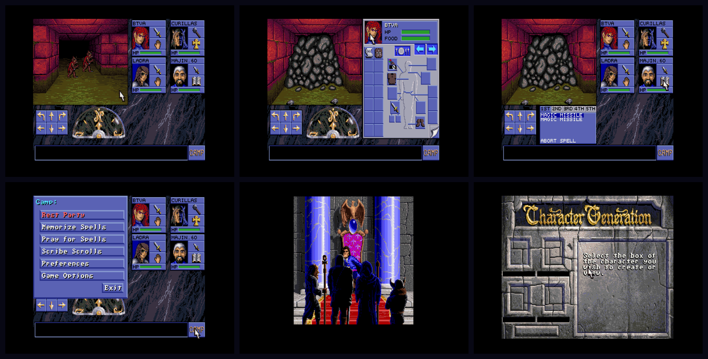

# Eye of the Beholder for MSX2 + V9990

**Explore all twelve levels beneath Waterdeep in this first-person dungeon RPG for MSX2.** An unofficial homage port by **DiHalt Studio**, 2026.



## Play it

Download the game ZIP and your player manual from the [GitHub releases](https://github.com/DiHaltStudio/eyeofthebeholder-msx2-v9990/releases). The ZIP includes the English and Spanish game in one installation. Copy its `SD/EOB` folder to the root of your writable DOS drive and leave the `ES` and `EN` folders in place. Select that drive in MSX-DOS 2 or Nextor and start the game:

```text
CD \EOB
EOB
```

You need an MSX2, MSX2+ or MSX turbo R with at least 512 KB of mapped RAM, a V9990 video cartridge, and an MSX mouse in port 1. Connect the main display to the V9990. The built-in VDP displays the automap. MoonSound is optional and plays the effects and introduction music.

- [English player manual](docs/manual/manual-en.pdf)
- [Manual del jugador en español](docs/manual/manual-es.pdf)

For openMSX, unzip the release at the root of this checkout. Set up Nextor and the emulator as described in the [build guide](docs/BUILDING.md#playing-in-openmsx), then use `make run-msx2` (Philips NMS 8245 with the 1 MB mapper expansion) or `make run-turbor`. You can also pass the path of the unpacked `SD/EOB` directory with `SD_DIR`.

| Action | Control |
| --- | --- |
| Move and turn | Arrow keys, `Z` and `X` to step sideways |
| Use an item or attack | Right-click a hand, or use `1`–`6` and `Q`–`Y` for the upper and lower hands |
| Interact, pick up or put down an item | Left-click |
| Rest, prepare spells, save or quit | Open CAMP and select the relevant option |

The Lords of Waterdeep send your party into the sewers to find what threatens the city. A cave-in seals the entrance, and the route leads deeper into the dungeon.

## What is this?

This Z80 port brings the DOS adventure to MSX-DOS 2 and Nextor. The V9990 draws the dungeon and party interface. The MSX video output shows a map of the passages you have explored. The launcher lets you switch between Spanish and English, and each language keeps its own save.

## Building from source

Place the Spanish and English DOS inputs and the ScummVM build data in `third_party/` following the [build guide](docs/BUILDING.md). The DOS originals and system files are not distributed here. `make` applies the port's data conversions and builds the complete `build/SD/EOB` directory. Use `make release VERSION=1.0` to package the game and two manuals, or `make manual` to rebuild the PDFs.

## Repository layout

| Directory | Contents |
| --- | --- |
| `src/` | Z80 launcher, game engine and overlays |
| `tools/` | Data conversion, packaging and optional emulator launcher |
| `assets/` | Port assets and initial MSX save |
| `docs/` | [Engine notes](docs/DESIGN.md), build guide and editable player manuals |
| `release/` | Output directory for the distributable ZIP and PDFs |

## Make it better

Please improve the game if you feel so! Improvements to the interface, controls and tools are welcome.

## Credits and rights

Original game by Westwood Associates, published by Strategic Simulations, Inc. (SSI), 1991. MSX port by DiHalt Studio. The game, art and associated names belong to their respective rights holders. This is an unofficial port made for study, preservation and homage.

The build uses SjASM and Pillow. The adapted AdLib data renderer is based on ScummVM code and includes the applicable notices in [`tools/adlib_render`](tools/adlib_render).
